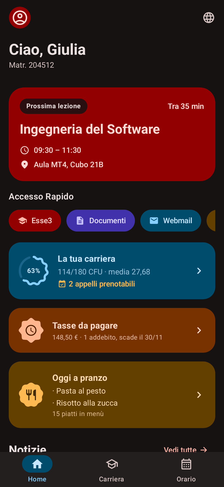
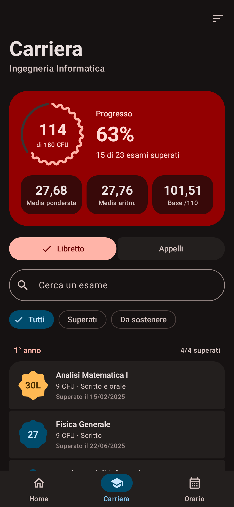
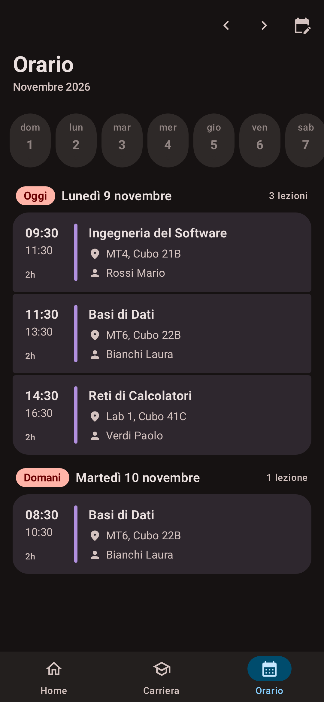
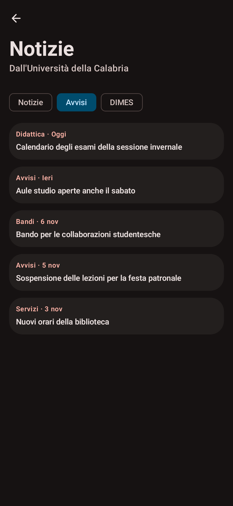
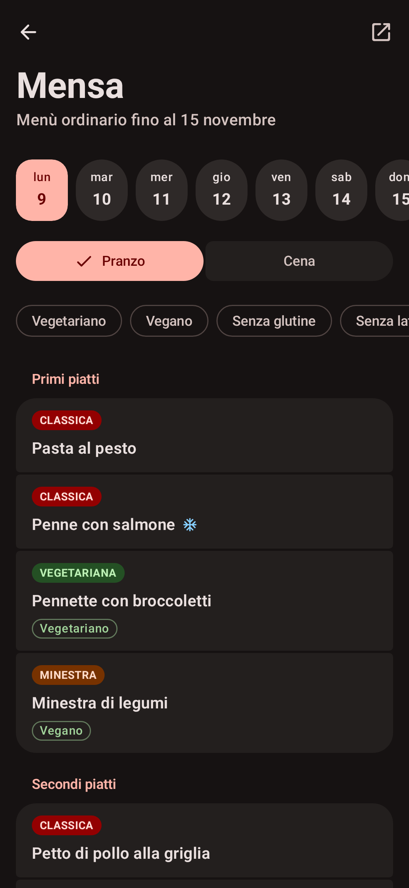

# MyUnical

App Android non ufficiale per chi studia all'**Università della Calabria**. Riunisce in un'unica app
quello che di solito è sparso fra Esse3, il portale dell'ateneo e i siti dei dipartimenti: carriera,
orario delle lezioni, tasse, notizie, rubrica e menù della mensa.

Scritta in Kotlin con Jetpack Compose e Material 3 Expressive.

<p align="center">
  
  
  
  
  
</p>

<p align="center"><sub>Gli screenshot usano dati inventati.</sub></p>

## Funzionalità

- **Home**: la prossima lezione o il prossimo appello, l'avanzamento della carriera, lo stato delle
  tasse e il prossimo pasto in mensa. Ci sono anche le ultime notizie, gli avvisi del tuo dipartimento
  e le azioni rapide (Esse3, certificati, webmail, biblioteche, mappa).
- **Carriera**: libretto con media ponderata e aritmetica e base di laurea, filtri e ordinamenti, appelli
  prenotabili e prenotazioni. Per ogni esame c'è la scheda dell'insegnamento con docenti, programma e
  link Teams, anche per gli esami a moduli.
- **Orario**: calendario delle lezioni dei corsi che segui. Si crea da solo a partire dalla carriera
  (corso di laurea, percorso ed esami ancora da sostenere). Puoi anche costruire altri orari scegliendo
  corso, percorso e insegnamenti.
- **Notizie**: notizie e avvisi dell'ateneo e del sito del tuo dipartimento, che viene riconosciuto
  dal corso di laurea.
- **Tasse**: addebiti pagati, da pagare e scaduti, con il collegamento al pagamento su Esse3.
- **Rubrica**: ricerca di docenti e personale, con contatti, insegnamenti e pubblicazioni.
- **Mensa**: menù settimanale di pranzo e cena, linee e filtri per dieta (vegetariano, vegano, senza
  glutine…).
- **Profilo**: cambio carriera, regolamento didattico del corso (quello della tua immatricolazione e
  quello in vigore) e collegamenti a diritto allo studio, portale e servizi del campus.

L'accesso usa le credenziali di Esse3 (codice fiscale e password). Restano salvate solo sul
dispositivo e servono a leggere i tuoi dati dalle API dell'ateneo. Non passano da nessun server terzo.

## Da dove vengono i dati

| Fonte | Usata per |
|---|---|
| Esse3 (`unical.esse3.cineca.it`, API REST) | accesso, profilo, libretto, appelli, prenotazioni, tasse |
| `storage.portale.unical.it` | offerta formativa, percorsi, orari delle lezioni, rubrica, schede insegnamento, dipartimenti |
| `www.unical.it` (uniCMS) | notizie e avvisi di ateneo e dei dipartimenti |
| PDF del menù della mensa | menù, convertito in JSON dentro l'app (vedi [`menus/README.md`](menus/README.md)) |

## Tecnologie

- **UI**: Jetpack Compose, Material 3 Expressive con palette dai colori dell'ateneo, Navigation 3
  con back predittivo e shared element.
- **Architettura**: moduli per livello e per funzionalità, MVVM con `StateFlow` e use case in un
  modulo Kotlin puro.
- **Librerie**: Ktor e kotlinx.serialization per la rete, DataStore per la persistenza, Koin per la
  dependency injection, Coil per le immagini.

```
app/            MainActivity, navigazione, tema, DI
core/domain     modelli, use case, interfacce (Kotlin puro)
core/network    client Ktor, DTO e data source remoti
core/datastore  DataStore e menù della mensa
core/ui         componenti Compose condivisi
features/       login, today (Home), career, schedule, taxes, news, directory, canteen
```

Una descrizione più dettagliata di moduli, API e schermate è in [`docs/claude/`](docs/claude).

## Compilare ed eseguire

Servono Android Studio (o JDK 17+ e Android SDK 37) e un dispositivo con **Android 13** o superiore.

```sh
./gradlew :app:assembleDebug
./gradlew :app:installDebug
```

Test unitari:

```sh
./gradlew :core:domain:test :core:datastore:testDebugUnitTest :core:network:testDebugUnitTest
```

### Screenshot

Le immagini di questo README sono preview Compose con dati di esempio
(`app/src/screenshotTest/.../ReadmeScreenshots.kt`), renderizzate con
[Compose Preview Screenshot Testing](https://developer.android.com/studio/preview/compose-screenshot-testing):

```sh
./gradlew :app:updateDebugScreenshotTest
cp app/src/screenshotTestDebug/reference/it/appm/myunical/screenshots/ReadmeScreenshotsKt/*_home_*.png docs/screenshots/home.png
# ...e lo stesso per career, schedule, news e canteen
```

`./gradlew :app:validateDebugScreenshotTest` confronta la UI attuale con le immagini di riferimento.

## Avvertenze

MyUnical è un progetto indipendente: **non è realizzato né approvato dall'Università della Calabria**
né da Cineca. Usa le API pubbliche dell'ateneo, che possono cambiare senza preavviso. Per scadenze,
pagamenti e prenotazioni fa fede il portale ufficiale.
